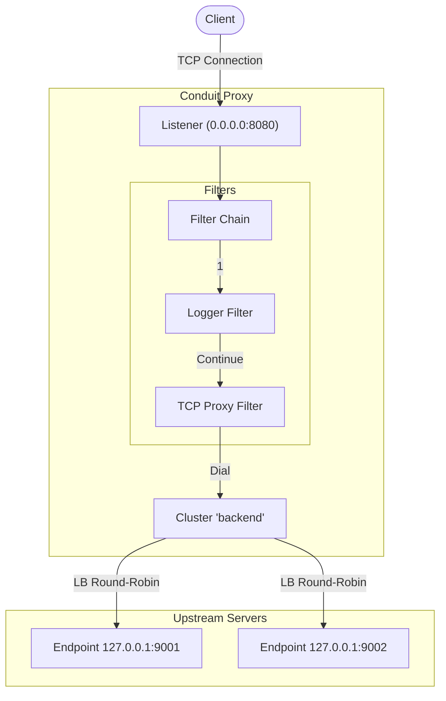

# Conduit

Conduit is a lightweight, modular L4 TCP proxy and load balancer written in Go. It enables you to define listeners that accept incoming TCP connections and route them to backend clusters using a round-robin load balancing strategy. 

It features a pluggable filter chain architecture (inspired by Envoy), currently supporting connection logging and TCP proxying.

## Features
- **TCP Proxying:** Seamlessly forward TCP traffic from downstream clients to upstream servers.
- **Load Balancing:** Round-robin load balancing across a pool of backend endpoints in a cluster.
- **Filter Chain Architecture:** Envoy-like modular design allowing connection lifecycle interception (e.g., logging, proxying).
- **Graceful Shutdown:** Handles `SIGINT` and `SIGTERM` signals for clean connection draining and unbinding.
- **JSON-based Configuration:** Easy-to-read JSON configuration for defining listeners and upstream clusters.

## Project Structure
- `main.go`: Application entrypoint. Handles configuration loading, component initialization, and signal handling.
- `pkg/api/`: Contains core interfaces and configuration data structures (`types.go`).
- `pkg/config/`: Configuration file parsing and loading logic (`loader.go`).
- `pkg/core/`: Core networking components including the `Listener` and `Cluster` managers.
- `pkg/filters/`: Implementations of network filters (`logger.go`, `tcp_proxy.go`).

## Building and Running

### Prerequisites
- [Go](https://golang.org/doc/install) (1.21 or later)

### Build
To build the executable, run the following command in the project root:
```bash
go build -o conduit main.go
```

*(On Windows, this will generate `conduit.exe`)*

### Run
To run Conduit, you need to provide a configuration file. The default path is `config.json` in the current directory.

```bash
./conduit -config config.json
```

## Configuration
The `config.json` file allows you to define `listeners` and `clusters`. Example:

```json
{
    "listeners": [
        {
            "name": "main_listener",
            "address": "0.0.0.0:8080"
        }
    ],
    "clusters": [
        {
            "name": "backend",
            "endpoints": [
                "127.0.0.1:9001",
                "127.0.0.1:9002"
            ],
            "connect_timeout": "5s"
        }
    ]
}
```
- **Listeners:** Define the IP address and port where Conduit will listen for incoming client connections.
- **Clusters:** Define upstream backend server pools. 
  - `endpoints`: list of backend servers to proxy traffic to.
  - `connect_timeout`: maximum time to wait when establishing a connection to an upstream endpoint.

## Architecture
1. **Listeners** accept incoming TCP connections.
2. Each connection is passed through an **Envoy-style chain of Network Filters**.
3. A `Logger` filter logs the new connection details.
4. A `TCPProxy` filter dials an upstream endpoint from the configured **Cluster** (using round-robin).
5. Data is then bidirectionally copied between the downstream client and the upstream server until the connection is closed.


